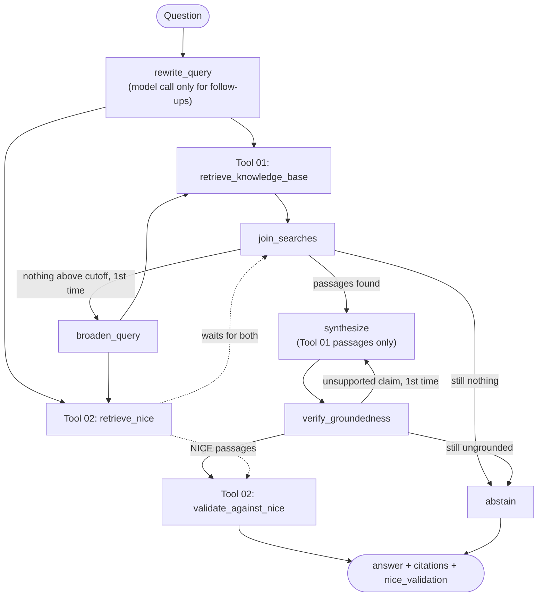

# Medical Knowledge Base API

A FastAPI service that answers clinical questions for medical staff. An agent,
built with LangGraph and MedGemma, uses two tools:

- **Tool 01: knowledge base.** The institution's curated guideline PDFs. Every
  answer is written from these passages alone.
- **Tool 02: NICE guidance.** NICE guideline PDFs. Every answer is checked
  against them after it is written. They are never used as answer material.

Each tool embeds its PDFs with `all-MiniLM-L6-v2` into its own local FAISS
index. There is no database to provision or migrate.

## Project structure

```text
backend/
├── main.py                        # App startup, middleware and routes
├── src/
│   ├── agent/                     # Agentic orchestration (LangGraph + MedGemma)
│   │   ├── agent.py               #   Entrypoint: answer_clinical_question()
│   │   ├── routes.py              #   POST /api/v1/agent/ask
│   │   ├── schemas.py             #   Request and response models for /ask
│   │   ├── graph.py               #   Session graph: knowledge_qa + chat memory
│   │   ├── state.py               #   Typed graph state
│   │   ├── citations.py           #   [n] passage numbering and citations
│   │   ├── ollama_client.py       #   The only code that calls the model
│   │   ├── knowledge_qa/          #   The graph that runs Tool 01 + Tool 02
│   │   └── memory/                #   Chat sessions and checkpoints
│   ├── tools/
│   │   ├── tool_01_knowledge_base/
│   │   │   ├── data/              #   Knowledge base PDFs
│   │   │   ├── service.py         #   Its vector store: index, search, sync
│   │   │   ├── nodes.py           #   retrieve_knowledge_base graph node
│   │   │   └── routes.py          #   /api/v1/rag endpoints
│   │   └── tool_02_nice_guidance/
│   │       ├── data/              #   NICE guideline PDFs
│   │       ├── service.py         #   Its vector store: index, search, sync
│   │       ├── nodes.py           #   retrieve_nice and validate_against_nice
│   │       ├── prompts.py         #   The NICE check prompt
│   │       └── routes.py          #   /api/v1/nice endpoints
│   └── shared/                    # Used by the agent and both tools
│       ├── config.py              #   Settings from the environment and .env
│       ├── errors.py              #   Application errors
│       ├── error_handlers.py      #   One JSON error format for every failure
│       ├── request_timing.py      #   X-Process-Time-Ms header
│       ├── embeddings.py          #   The sentence-embedding model
│       ├── vector_store.py        #   A FAISS index with its metadata
│       ├── indexing.py            #   Chunk, embed and search text in a store
│       ├── documents.py           #   PDF extraction and folder sync
│       ├── document_routes.py     #   The document endpoints both tools mount
│       └── schemas.py             #   Document request and response models
├── tests/                         # Mirrors src/: agent/, tools/, shared/
└── var/                           # Generated FAISS indexes, one per tool
```

Both tools have the same layout. `shared/` never imports from `agent/` or
`tools/`, so both can use it without import cycles.

## Run it

Install the project and development test tools:

```powershell
uv sync --group dev
```

Start the development server:

```powershell
uv run python -m fastapi dev main.py
```

Tools are run through `python -m` because Windows Smart App Control can block
the unsigned `.exe` launchers uv creates in `.venv\Scripts`. It also blocks a
native DLL in scikit-learn 1.9.1, which `sentence-transformers` depends on, so
`pyproject.toml` pins scikit-learn to 1.7.2. If another package gets blocked,
Event Viewer names the file under Applications and Services Logs → Microsoft →
Windows → CodeIntegrity → Operational; pin that package to a version that
loads.

Open <http://127.0.0.1:8000/docs> to try the generated OpenAPI documentation.
On startup the application loads the embedding model and syncs each tool's
`data/` folder into its FAISS index. This runs in the background, so the port
opens immediately.

To add a PDF, drop it into the tool's `data/` folder and restart, or upload it
through the tool's endpoint. Files are tracked by a hash of their content, so
unchanged PDFs are not re-embedded, edited ones are re-indexed, and deleted ones
are removed from the index. Scanned PDFs without a text layer are skipped with a
warning. After changing how PDFs are extracted, call the tool's `reindex`
endpoint, because an unchanged file is not re-read on restart.

> **Run one worker only.** Chat sessions are held in process memory. Under more
> than one uvicorn worker, consecutive requests for the same session land on
> different processes at random and conversation memory appears to vanish
> intermittently. Use `--workers 1` until session memory is moved into
> a shared store. `fastapi dev` is already single-worker. The FAISS indexes are
> also held in process memory, so a second worker would not see uploads made
> through the first.

## How a question is answered

`POST /api/v1/agent/ask` runs the agent. Answers are generated by
**MedGemma 1.5 (4B)** running locally in [Ollama](https://ollama.com); nothing
leaves the machine. Install and start Ollama, then pull the model once:

```powershell
ollama pull medgemma1.5:4b
```

Every question goes to the **knowledge_qa** graph (`agent/knowledge_qa/`):

1. A follow-up question is rewritten into a standalone search query using the
   chat history. A first question is searched as asked, with no model call.
2. **Tool 01 and Tool 02 search at the same time** with that query.
3. If Tool 01 finds nothing above its similarity cutoff
   (`KNOWLEDGE_BASE_MIN_SCORE`), the query is broadened once and both tools
   search again. There is no separate relevance-grading call.
4. An answer is written from Tool 01's passages only, citing each claim `[n]`.
5. A groundedness audit rejects unsupported claims. The answer is rewritten
   once, or the assistant abstains instead of guessing.
6. **Tool 02** checks the verified answer against its NICE passages and reports
   `nice_validation` next to it.

A first question makes three model calls: the answer, the groundedness audit
and the NICE check. A follow-up adds the rewrite, and an empty search adds the
broadening. There is no routing step, so an off-topic question gets the
knowledge base's "no information" abstention rather than a separate decline.
If Ollama is not running, or the embedding model cannot load, the endpoint
returns `503 agent_unavailable`. An abstention is reported as
`"confidence": "abstained"`.



Session memory is keyed on `session_id`: send back the value from a previous
answer to ask a follow-up in the same conversation. Memory lasts for the process
lifetime and is not persisted.

### Tool 02's check

The check reports next to the answer and never changes the answer or its
confidence:

| Status | Meaning |
| --- | --- |
| `consistent` | NICE addresses the answer and contradicts none of it |
| `conflicts` | NICE disagrees; each point is listed with its NICE passage markers |
| `not_covered` | No NICE passage addresses the answer |
| `unavailable` | The NICE search or the check failed; the answer is still returned |
| `not_run` | There was no answer to check (abstained or out of scope) |

MedGemma gives each claim in the answer a verdict: it agrees with NICE,
contradicts it, or isn't addressed. The code then works out the status and
writes the summary. A verdict only counts if it cites a real NICE passage, and
a contradiction also has to say what NICE says instead. Otherwise the claim
counts as not addressed, so a point NICE never mentions can't show up as a
conflict. The check fails open because the answer has already been verified
against the knowledge base.

Example of an answer that NICE disagrees with:

```json
"nice_validation": {
  "status": "conflicts",
  "summary": "NICE guidance disagrees with 1 claim in this answer.",
  "conflicts": [
    {
      "claim": "Start with a sulfonylurea.",
      "nice_position": "Start with metformin, then add an SGLT-2 inhibitor.",
      "markers": [1]
    }
  ],
  "citations": [
    {"marker": 1, "chunk_id": "...", "document_id": "pdf-...",
     "title": "Type 2 diabetes in adults: management", "score": 0.70}
  ]
}
```

The check is done by a 4B model, so treat its verdicts as a prompt to look,
not as a ruling, and spot-check them against the cited NICE passages.

## Configuration

Every setting is optional; copy `.env.example` to `.env` to override one.
Defaults live in `src/shared/config.py`.

| Variable | Default | Purpose |
| --- | --- | --- |
| `OLLAMA_BASE_URL` | `http://localhost:11434` | Where Ollama is listening |
| `OLLAMA_MODEL` | `medgemma1.5:4b` | The agent's model |
| `OLLAMA_NUM_CTX` | `8192` | Context window; keep it fixed, as a change reloads the model |
| `OLLAMA_TIMEOUT_SECONDS` | `300` | Longest wait for one model call |
| `OLLAMA_KEEP_ALIVE` | `30m` | How long Ollama keeps the model loaded when idle |
| `AGENT_MAX_ANSWER_TOKENS` | `2048` | Answer length cap, including MedGemma's thinking |
| `EMBEDDING_MODEL_NAME` | `sentence-transformers/all-MiniLM-L6-v2` | Embedding model for both tools |
| `MAX_UPLOAD_BYTES` | `20971520` | Largest accepted PDF upload (20 MB) |
| `KNOWLEDGE_BASE_DOCUMENTS_DIR` | `src/tools/tool_01_knowledge_base/data` | Tool 01's PDFs |
| `KNOWLEDGE_BASE_VECTOR_STORE_DIR` | `var/tool_01_knowledge_base` | Tool 01's FAISS index |
| `KNOWLEDGE_BASE_TOP_K` | `8` | Tool 01 passages fetched per search |
| `KNOWLEDGE_BASE_MIN_SCORE` | `0.35` | Cosine floor for Tool 01 passages |
| `NICE_DOCUMENTS_DIR` | `src/tools/tool_02_nice_guidance/data` | Tool 02's PDFs |
| `NICE_VECTOR_STORE_DIR` | `var/tool_02_nice_guidance` | Tool 02's FAISS index |
| `NICE_TOP_K` | `6` | Distinct Tool 02 passages given to the check |
| `NICE_MIN_SCORE` | `0.35` | Cosine floor for Tool 02 passages |
| `SESSION_MAX_TURNS` | `20` | History window kept per session |
| `SESSION_TTL_SECONDS` | `3600` | Idle lifetime before a session is evicted |

## API

| Method | Endpoint | Purpose |
| --- | --- | --- |
| `GET` | `/health` | Application health check |
| `POST` | `/api/v1/agent/ask` | Answer a clinical question from Tool 01, checked by Tool 02 |

Each tool mounts the same document endpoints: Tool 01 under `/api/v1/rag`,
Tool 02 under `/api/v1/nice`.

| Method | Endpoint | Purpose |
| --- | --- | --- |
| `GET` | `/documents` | List every document in the tool's store |
| `POST` | `/documents` | Index plain text, searchable immediately |
| `POST` | `/documents/upload` | Upload a PDF (multipart field `file`); saved to the tool's `data/` folder and indexed. A name already in use gets a `_2`, `_3`... suffix; nothing is replaced |
| `DELETE` | `/documents/{document_id}` | Remove a document (and its PDF file, for PDFs) |
| `POST` | `/reindex` | Rebuild the store from the tool's `data/` folder |
| `GET` | `/stats` | Report how much is searchable |

These write endpoints change what the assistant treats as ground truth and are
unauthenticated. Put them behind an owner-only guard before running this
anywhere but a development machine.

Example upload to Tool 02:

```powershell
curl.exe -F "file=@headaches.pdf" http://127.0.0.1:8000/api/v1/nice/documents/upload
```

Every error, expected or not, returns the same JSON body
(`{"error": ..., "message": ...}`) through the handlers in
`src/shared/error_handlers.py`.

## Tests

```powershell
uv run python -m pytest
```

`tests/` mirrors `src/`: `agent/`, `tools/` and `shared/`. No test needs Ollama
or the real embedding model. The model is replaced by a scripted stub
(`tests/graph_stubs.py`), and embeddings by a small fixed vector space so
retrieval can be asserted exactly. Each test that touches a vector store gets
temporary directories, so the suite never modifies `var/` or the tools' `data/`
folders.

The agent tests cover the graph's control flow: when it answers, retries a
search, rewrites an ungrounded answer, or refuses. The Tool 02 tests check that
both tools search in the same step, that NICE text never reaches the prompts
that write the answer, and that each check status is reached.
